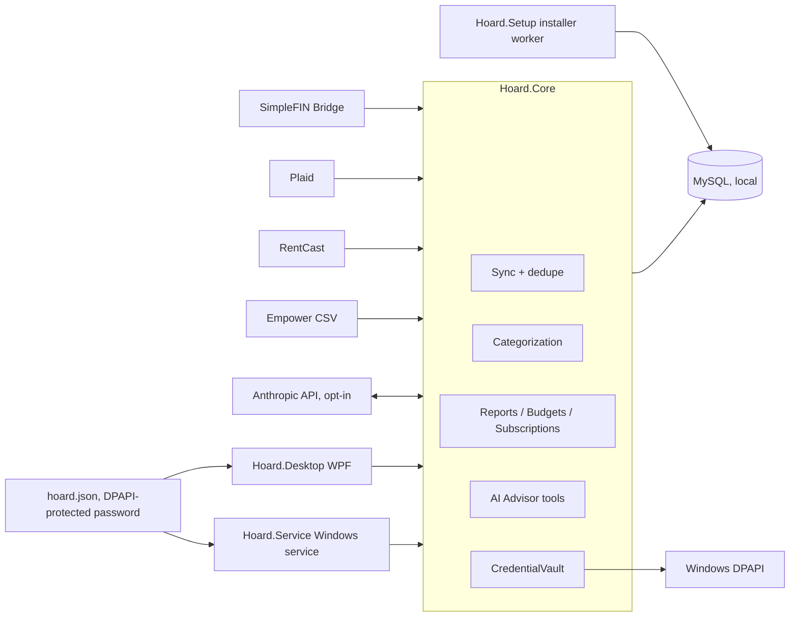
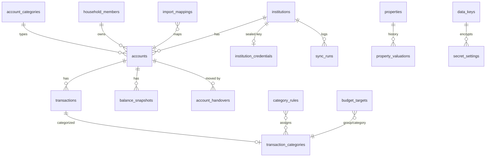

# Architecture

Hoard is a single-user, local-first Windows application. All logic sits in a UI-free class library (`Hoard.Core`). Two executables share it: a WPF desktop app and a Windows-service sync worker. Data lives in a MySQL database on the user's PC (bundled by the MSI, bound to 127.0.0.1:3307). Settings are in `%ProgramData%\Hoard\hoard.json`.

## Parts

- **Hoard.Core**: providers (SimpleFIN, Plaid, RentCast real estate behind `IFinancialProvider`), the sync engine with three-layer duplicate protection, categorization, CSV import, duplicate-account detection and merge, account handover, budgeting and forecasting, reporting queries, subscription detector, the AI advisor (Anthropic SDK, with local tools), and security (credential vault, DPAPI protector). Data access is Dapper over MySqlConnector; SQL migrations are embedded and applied at startup.
- **Hoard.Desktop**: WPF-UI (Fluent) shell, MVVM with CommunityToolkit, LiveCharts2 charts.
- **Hoard.Service**: worker host that runs the sync on a timer.
- **Hoard.Setup**: installer worker and repair tool (provisions MySQL, the database user, ACLs and the service).
- **installer/**: WiX v5 sources and build scripts.
- **tests/Hoard.Core.Tests**: xUnit tests using in-memory fakes, so no database is needed.

## Data model

Money is `DECIMAL(19,4)`; timestamps are UTC. Tables are summarised from the migrations; columns are omitted.

Other tables: `settings`, `schema_migrations`, `secret_settings` (sealed Anthropic and similar keys).
